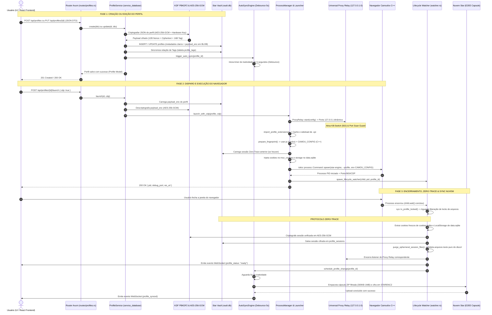
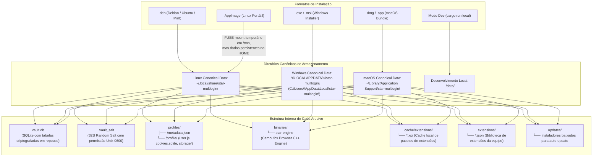

# 🌟 Arquitetura Oficial do Star Multlogin Backend (Rust / Axum)

> **Documento de Engenharia & Arquitetura de Software**  
> **Versão do Sistema**: 1.0.0 (Compatível com Tauri v2 & Standalone)  
> **Motor Antidetect**: Camoufox C++ (Gecko / Firefox Core) & Chromium  
> **Linguagem / Stack**: Rust (Edição 2024), Axum 0.8, Tokio Async Runtime, SQLite (Star Vault), AES-256-GCM, Zeroize.

---

## 📑 Índice
1. [Visão Geral e Propósito](#1-visão-geral-e-propósito)
2. [Topologia Geral e Modos de Execução](#2-topologia-geral-e-modos-de-execução)
   - [2.1 Diagrama Moderno: Ciclo Completo de Vida do Perfil](#21-diagrama-moderno-ciclo-completo-de-vida-do-perfil)
3. [Segurança e Blindagem em Nível de SO & Memória](#3-segurança-e-blindagem-em-nível-de-so--memória)
4. [Persistência de Dados: O Star Vault (SQLite + Criptografia)](#4-persistência-de-dados-o-star-vault-sqlite--criptografia)
   - [4.1 Derivação de Chave Mestre (Hardware-Bound KDF)](#41-derivação-de-chave-mestre-hardware-bound-kdf)
   - [4.2 Esquema do Banco SQLite (vault.db)](#42-esquema-do-banco-sqlite-vaultdb)
   - [4.3 Diagrama Dedicado: Onde Ficam os Dados por Sistema Operacional & Formato (.AppImage, .deb, .exe, .msi, .dmg)](#43-diagrama-dedicado-onde-ficam-os-dados-por-sistema-operacional--formato-appimage-deb-exe-msi-dmg)
5. [Subsistema de Rede: Universal Proxy Relay & Kill-Switch](#5-subsistema-de-rede-universal-proxy-relay--kill-switch)
6. [Motor de Impressão Digital (Fingerprint & Tradução Camoufox)](#6-motor-de-impressão-digital-fingerprint--tradução-camoufox)
7. [Orquestração de Navegadores & Ciclo de Vida (Launcher Engine)](#7-orquestração-de-navegadores--ciclo-de-vida-launcher-engine)
8. [Zero-Trace Session & Injeção SQLite (Cookies & LocalStorage)](#8-zero-trace-session--injeção-sqlite-cookies--localstorage)
9. [Sincronização em Nuvem E2EE & Auto-Sync Debounced](#9-sincronização-em-nuvem-e2ee--auto-sync-debounced)
10. [Subsistema MCP (Model Context Protocol & Automação IA)](#10-subsistema-mcp-model-context-protocol--automação-ia)
11. [Motor de Atualizações do App e Download de Binários](#11-motor-de-atualizações-do-app-e-download-de-binários)
12. [Comunicação em Tempo Real (WebSocket Axum)](#12-comunicação-em-tempo-real-websocket-axum)
13. [Gerador de IDs Únicos e Monotônicos (Base62)](#13-gerador-de-ids-únicos-e-monotônicos-base62)
14. [Mapa Estrutural de Pastas e Módulos](#14-mapa-estrutural-de-pastas-e-módulos)

---

## 1. Visão Geral e Propósito

O **Star Multlogin Backend** é o núcleo de alta performance e segurança do ecossistema Star Multlogin. Desenvolvido 100% em **Rust assíncrono**, é responsável por:
1. **Isolar completamente perfis de navegação**: cada perfil opera em uma sandbox própria com diretório individual, banco de cookies isolado, identificadores e configurações de rede exclusivas.
2. **Enganar sistemas avançados de detecção (Anti-Bot / Fingerprinting)**: traduz configurações de hardware, GPU, Canvas, WebGL, WebRTC, áudio e fontes em variáveis C++ nativas (`CAMOU_CONFIG`) e preferências do Gecko (`user.js`).
3. **Impedir vazamento de credenciais e IP real**: através de um Proxy Relay loopback local com **Kill-Switch integrado** e **Port Scan Protection**.
4. **Garantir privacidade Zero-Knowledge & Zero-Trace**: dados confidenciais são cifrados com AES-256-GCM tanto em repouso no disco local (Star Vault) quanto em trânsito para a nuvem (Cápsulas E2EE `STARENC2`).
5. **Permitir automação de agentes de IA**: fornece um servidor nativo **MCP (Model Context Protocol)** sobre SSE (Server-Sent Events) e REST protegido contra ataques cibernéticos.

---

## 2. Topologia Geral e Modos de Execução

O backend foi construído com arquitetura dual:

```
┌─────────────────────────────────────────────────────────────┐
│                    Tauri v2 Desktop App                     │
│  ┌───────────────────────┐       ┌───────────────────────┐  │
│  │   Frontend React/Vite │◄─────►│   Backend Axum 0.8    │  │
│  │  (localhost:1254)     │  IPC  │  (127.0.0.1:12540)    │  │
│  └───────────────────────┘ HTTP/ │  (spawned in runtime) │  │
│                             WS   └──────────┬────────────┘  │
└─────────────────────────────────────────────┼───────────────┘
                                              ▼
                             ┌─────────────────────────────────┐
                             │  Motor Camoufox / Processos SO  │
                             └─────────────────────────────────┘
```

1. **Modo Tauri Embutido**:
   - No `app/src-tauri/src/lib.rs`, o método `tauri::async_runtime::spawn` executa `star_multlogin_backend::start_star_server(Some(data_dir), 12540)`.
   - O backend sobe dentro da mesma instância do processo principal do Tauri, compartilhando o ciclo de vida da interface gráfica.
2. **Modo Standalone (CLI / Servidor / Container)**:
   - Através de `src/main.rs`, compilado como binário independente `backend`.
   - Lê variáveis de ambiente:
     - `STAR_DATA_DIR`: diretório de dados (se omitido, usa o caminho canônico do SO).
     - `STAR_BACKEND_PORT`: porta TCP de escuta (padrão: `12540`).

---

### 2.1 Diagrama Moderno: Ciclo Completo de Vida do Perfil

O diagrama abaixo detalha a rota ponta a ponta desde o momento em que o usuário cria ou edita um perfil na interface visual, como esses dados trafegam pela criptografia do backend até chegarem gravados no SQLite, como o motor é configurado e disparado no sistema operacional, e o ciclo Zero-Trace no fechamento:



---

## 3. Segurança e Blindagem em Nível de SO & Memória

Arquivo: [`src/security/memory_guard.rs`](src/security/memory_guard.rs)

O backend possui rotinas de proteção contra inspeção de processos e extração indevida de dados da RAM:

1. **Anti-Dump & Anti-Ptrace (`harden_process_memory`)**:
   - No Linux, executa `prctl(PR_SET_DUMPABLE, 0)`.
   - Impede a geração de Core Dumps (que poderiam despejar chaves e cookies no disco em falhas) e bloqueia anexos de depuradores externos (`ptrace` / `/proc/$PID/mem`) por malwares ou processos invasores.
2. **Proteção de Chaves de Criptografia (`ProtectedKey`)**:
   - Envolve as chaves mestras de 256 bits (`[u8; 32]`).
   - Implementa a trait `zeroize::ZeroizeOnDrop`, garantindo que, assim que a chave sai de escopo na memória, seus bytes sejam imediatamente sobrescritos por `0x00`.

---

## 4. Persistência de Dados: O Star Vault (SQLite + Criptografia)

Arquivos: [`src/service_database/`](src/service_database/) e [`src/security/database/`](src/security/database/)

Ao invés de salvar metadados e credenciais em arquivos JSON abertos ou bancos desprotegidos, o sistema opera o **Star Vault**:

### 4.1 Derivação de Chave Mestre (Hardware-Bound KDF)
- Arquivo de salt exclusivo: `<data_dir>/.vault_salt` (32 bytes aleatórios do `OsRng`, permissão Unix `0600`).
- Semente da Máquina: Combinação do identificador de hardware do SO (`/etc/machine-id` ou `/var/lib/dbus/machine-id`), usuário logado (`$USER` ou `$USERNAME`) e pasta do usuário (`$HOME`).
- Algoritmo KDF: **PBKDF2-HMAC-SHA256 com 100.000 iterações**.
- Formato da Cifra: **AES-256-GCM** com Nonce aleatório de 12 bytes gerado via `OsRng`. Estrutura do payload:
  `[12 bytes Nonce || Dados Cifrados || 16 bytes Tag de Autenticação GCM]`

### 4.2 Esquema do Banco SQLite (`vault.db`)
O arquivo [`src/service_database/data/schema.rs`](src/service_database/data/schema.rs) centraliza o DDL:
- `profiles`: Metadados indexáveis (id, name, group_name, status, kernel, os, created_at, is_deleted) + `payload_enc` (BLOB criptografado contendo o JSON integral do perfil).
- `proxies`: Metadados de rede + `credentials_enc` (BLOB criptografado das credenciais de autenticação).
- `tags` e `profile_tags`: Tags com cores hexadecimais e relação N:N indexada com `ON DELETE CASCADE`.
- `auth_sessions`: Sessão do usuário autenticado no ecossistema Star (`session_enc` em AES-256-GCM).
- `profile_sessions`: Sessões salvas pelo mecanismo Zero-Trace (`session_enc` em BLOB).
- `mcp_tokens`: Tokens de automação local para o protocolo MCP.
- `extension_categories`: Categorias e kits pré-configurados de extensões.

---

### 4.3 Diagrama Dedicado: Onde Ficam os Dados por Sistema Operacional & Formato (.AppImage, .deb, .exe, .msi, .dmg)

A resolução do diretório canônico é controlada estritamente por [`src/browser_downloader/platform.rs`](src/browser_downloader/platform.rs) através do método `get_canonical_app_dir()`.

Abaixo está o mapa visual completo da árvore de armazenamento e os caminhos absolutos exatos conforme a plataforma e o empacotador utilizado:



#### Tabela Comparativa Detalhada por Formato e Sistema Operacional

| Sistema Operacional | Formato de Pacote | Onde fica o Executável da Aplicação | Onde ficam os Dados Persistentes (`data_dir`) | Comportamento Específico de Instalação |
|---|---|---|---|---|
| **Linux** | **Pacote `.deb`** (Instalador Nativo) | `/usr/bin/star-multlogin`<br/>`/usr/lib/star-multlogin/` | `~/.local/share/star-multlogin/` | Instalado como pacote raiz do sistema via `dpkg -i`. Ícones integrados em `/usr/share/applications/`. O banco e os perfis residem isolados no diretório XDG do usuário comum sem requerer permissões de root. |
| **Linux** | **Pacote `.AppImage`** (Portátil Autônomo) | Qualquer pasta do usuário (ex: `~/Downloads` ou `~/Applications`) | `~/.local/share/star-multlogin/` | O AppImage monta um sistema de arquivos somente-leitura efêmero em `/tmp/.mount_star-XXXXXX/`. **A persistência NUNCA é perdida**, pois o backend lê o `$HOME` real do usuário e grava em `~/.local/share/star-multlogin/`. |
| **Windows** | **Instalador `.exe` / `.msi`** | `C:\Program Files\star-multlogin\` ou `%LOCALAPPDATA%\Programs\star-multlogin\` | `%LOCALAPPDATA%\star-multlogin\`<br/>(`C:\Users\<User>\AppData\Local\star-multlogin\`) | Instalado via NSIS ou MSI. Dados, cofre `vault.db`, cookies e binários do Camoufox (`star-engine.exe`) residem na pasta local de aplicativo do usuário (`LocalAppData`). |
| **macOS** | **Pacote `.dmg` / `.app`** | `/Applications/Star Multlogin.app` | `~/Library/Application Support/star-multlogin/` | Aplicativo montado e movido para `/Applications`. Segue rigorosamente as diretrizes da Apple, salvando o Vault, perfis e o binário C++ do Camoufox dentro de `Application Support`. |
| **Qualquer SO** | **Modo Desenvolvimento** | Executado via `cargo run --bin backend` | `./data/` (se existir na raiz) | Caso uma pasta `./data` exista na raiz de execução, o sistema prioriza o diretório local para facilitar testes e depuração sem interferir nos perfis reais instalados no SO. |

#### O que é Armazenado em Cada Arquivo Dentro de `<data_dir>`:

1. **`<data_dir>/vault.db`**:
   - Banco de dados SQLite unificado do sistema.
   - **Tabelas**: `profiles`, `proxies`, `tags`, `profile_tags`, `auth_sessions`, `profile_sessions`, `mcp_tokens`, `extension_categories`.
   - **Segurança**: As colunas de busca (ex: `name`, `status`, `group_name`, `created_at`) ficam em texto plano indexado, enquanto os corpos sensíveis de dados (`payload_enc`, `credentials_enc`, `session_enc`) são guardados como **BLOBs cifrados em AES-256-GCM**.
2. **`<data_dir>/.vault_salt`**:
   - Arquivo contendo 32 bytes de entropia pura gerada por `OsRng`.
   - No Linux e macOS, possui permissões Unix estritas `0600` (apenas leitura e escrita pelo dono do processo).
   - Componente chave da derivação KDF de 100.000 iterações.
3. **`<data_dir>/profiles/<profile_id>/`**:
   - **`metadata.json`**: Cópia local legível do perfil mantida em sincronia para recuperação rápida e inspeção de status.
   - **`profile/`**: Sandbox isolada da engine Gecko/Camoufox:
     - `user.js`: Preferências injetadas antes do startup do navegador (restauração de abas Donut, autofill, regras WebRTC).
     - `cookies.sqlite`: Banco nativo do Firefox onde a injeção e extração de cookies operam diretamente via SQL.
     - `storage/default/<escaped_origin>/ls/data.sqlite`: Particionamento padrão do Firefox onde o LocalStorage de cada site é injetado.
     - `extensions/`: Pasta de add-ons descompactados ou `.xpi` preparados para o perfil.
4. **`<data_dir>/binaries/`**:
   - Binário do navegador antidetect baixado pelo `BrowserDownloadService`.
   - Contém o executável `star-engine` (ou `star-engine.exe`), bibliotecas C++ associadas e componentes do Camoufox.
5. **`<data_dir>/cache/extensions/`**:
   - Cache de pacotes de extensões `.xpi` baixados da loja Firefox Add-ons (AMO), evitando downloads duplicados entre perfis.
6. **`<data_dir>/extensions/`**:
   - Biblioteca de extensões adicionadas pelo usuário ou compartilhadas pela equipe (arquivos `<id>.json`).
7. **`<data_dir>/updates/`**:
   - Diretório onde o [`src/routes/app_update.rs`](src/routes/app_update.rs) realiza o download em stream das atualizações do próprio aplicativo antes de disparar o comando de substituição.

---

## 5. Subsistema de Rede: Universal Proxy Relay & Kill-Switch

Arquivo: [`src/network/relay.rs`](src/network/relay.rs)

Configurar credenciais upstream diretamente no Firefox gera alertas de senha pop-up e riscos de vazamento de DNS. Para mitigar isso, o backend implementa um **servidor proxy in-process em tempo real**:

```
Camoufox (Sem Auth) ──► 127.0.0.1:<Porta_Dinâmica> ──► [Proxy Relay] ──► Upstream Proxy (Auth) ──► Destino Final
                             (Kill-Switch & Port Scan Guard)
```

### Características Críticas:
1. **Loopback Dinâmico**: O Relay é instanciado em uma porta efêmera aleatória (`127.0.0.1:0`) exclusiva para aquele perfil ativo.
2. **Kill-Switch Ativo**: Se o proxy upstream (HTTP ou SOCKS5) cair ou falhar a autenticação, o Relay retorna imediatamente `502 Bad Gateway` com o cabeçalho `X-Kill-Switch: active`. O tráfego **jamais cai na rede local direta**, eliminando o risco de exposição do IP real do usuário.
3. **Port Scan Protection**: Impede que scripts web de páginas acessadas usem conexões `fetch()` para varrer a rede local do usuário (portas privadas, hosts 127.0.0.1, 192.168.x.x, 10.x.x.x).
4. **Isolamento de DNS Remoto**: No caso de SOCKS5, resolve nomes no lado do proxy remoto (`socks5_connect`), evitando DNS Leaks.

---

## 6. Motor de Impressão Digital (Fingerprint & Tradução Camoufox)

Arquivos: [`src/fingerprint/`](src/fingerprint/)

O Star Multlogin utiliza o **Camoufox**, um navegador baseado em Firefox C++ modificado especificamente para anti-detecção. A injeção de fingerprint é dividida em dois níveis fundamentais:

```
                  ┌──────────────────────────────┐
                  │ Perfil: fingerprint_json     │
                  └──────────────┬───────────────┘
                                 │
                 ┌───────────────┴───────────────┐
                 ▼                               ▼
       [prefs.rs -> user.js]         [translator.rs -> CAMOU_CONFIG]
    - browser.sessionstore         - navigator.userAgent & platform
    - signon / formfill            - hardwareConcurrency (CPU Cores)
    - CDP & Remote BiDi            - screen.* / window.devicePixelRatio
    - network.proxy.*              - webGl:vendor & webGl:renderer
    - WebRTC media restrictions    - canvas:seed / audio:seed
                                   - fonts allowlist
                                   - webrtc:ipv4 spoofing
```

### 1. Injeção no `user.js` (Gecko Engine)
- Configura persistência de abas (estilo Donut Browser), impedindo descarte de sessão e abas fechadas.
- Ativa suporte a automação remota (`remote.active-protocols = 3`).
- Permite extensões sideloaded sem assinatura obrigatória (`xpinstall.signatures.required = false`).

### 2. Injeção na variável de ambiente `CAMOU_CONFIG` (C++ Engine)
- **Canvas & Áudio Noise**: Sementes pseudo-aleatórias determinísticas (`u32`) convertidas a partir de seeds hexadecimais.
- **WebGL Spoofing**: Simula fabricantes de placas de vídeo realistas (ex: NVIDIA GeForce RTX 3060 Direct3D11 para Windows, Apple M2 para macOS).
- **Fontes Permitidas (`fonts.rs`)**: Submete ao Camoufox uma lista rigorosa de fontes nativas do sistema operacional simulado, bloqueando que sites descubram o SO real via enumeração de fontes CSS.
- **WebRTC IPv4 Spoofing**: Injeta o IPv4 público do proxy no motor de WebRTC nativo (`webrtc:ipv4`), evitando discrepâncias entre o IP HTTP e o IP WebRTC.

---

## 7. Orquestração de Navegadores & Ciclo de Vida (Launcher Engine)

Arquivos: [`src/launcher/engine/`](src/launcher/engine/)

O gerenciador de processos [`ProcessManager`](src/launcher/engine/manager.rs) controla a execução e o isolamento dos navegadores:

1. **Preparo do Ambiente (`prefs::prepare_profile_dir`)**:
   - Cria o diretório isolado do perfil.
   - Dispara o Proxy Relay correspondente.
   - Baixa e faz cache de extensões XPI necessárias.
   - Injeta o `user.js` e compõe o `CAMOU_CONFIG`.
2. **Injeção de Abas & Automação BiDi (`tab_manager.rs`)**:
   - Conecta via WebSocket ao endpoint WebDriver BiDi do Camoufox (`ws://127.0.0.1:{port}/session`).
   - Gerencia abas de navegação sob demanda (`browsingContext.getTree`, `browsingContext.create`, `browsingContext.close`).
3. **Monitoramento e Watcher Assíncrono (`watcher.rs`)**:
   - Executa `tokio::spawn` para esperar o encerramento do processo (`child.wait()`).
   - Verifica liberação de file locks do SQLite do navegador (`sys::is_profile_locked`).
   - Executa o protocolo **Zero-Trace** (descrito a seguir).
   - Encerra o listener do Proxy Relay correspondente.
   - Atualiza o status do perfil no Vault e emite evento WebSocket `ProfileStatus { status: "ready" }`.
   - Agenda sincronização na nuvem via `AutoSyncEngine`.

---

## 8. Zero-Trace Session & Injeção SQLite (Cookies & LocalStorage)

Arquivos: [`src/launcher/engine/injection.rs`](src/launcher/engine/injection.rs) e [`src/extraction_session/`](src/extraction_session/)

Para evitar que sessões de contas (Google, Facebook, TikTok) sejam perdidas ou roubadas por arquivos temporários deixados no disco:

### 8.1 Injeção Direta
- **Cookies**: Abre o arquivo SQLite `cookies.sqlite` do perfil e executa comandos parametrizados na tabela `moz_cookies`. Suporta importação via JSON ou formato Netscape / Curl.
- **LocalStorage**: Grava pares chave/valor diretamente nos bancos `data.sqlite` da estrutura de diretórios particionada do Firefox (`storage/default/<escaped_origin>/ls/data.sqlite`).

### 8.2 Protocolo Zero-Trace no Fechamento
1. Assim que o navegador encerra, o [`watcher.rs`](src/launcher/engine/watcher.rs) lê todos os cookies frescos e dados de LocalStorage gravados na sessão.
2. Esses dados são unificados em um `UnifiedSession` e criptografados em **AES-256-GCM** dentro do Star Vault (`profile_sessions`).
3. O método `purge_ephemeral_session_files` purga arquivos em texto puro e temporários (`.sqlite-wal`, `.sqlite-shm`, `.parentlock`) do disco.

---

## 9. Sincronização em Nuvem E2EE & Auto-Sync Debounced

Arquivos: [`src/server_sync/cloud_sync/`](src/server_sync/cloud_sync/)

### 9.1 Cápsulas E2EE Zero-Knowledge (`STARENC2`)
Arquivo: [`src/server_sync/cloud_sync/crypto.rs`](src/server_sync/cloud_sync/crypto.rs)
- Os dados do perfil são empacotados em um arquivo ZIP e criptografados com a chave pessoal do usuário antes de saírem do computador local.
- **Cabeçalho Mágico**: `STARENC2` (8 bytes) + Salt (16 bytes) + Nonce (12 bytes) + Ciphertext + Tag (16 bytes).
- **KDF**: PBKDF2-HMAC-SHA256 (100.000 iterações).
- O servidor em nuvem Star **nunca tem acesso à chave ou aos dados do perfil em texto puro**.

### 9.2 Filtro Inteligente de Cápsula (`filter.rs`)
Para economizar banda e armazenamento em nuvem, diretórios de perfis de centenas de megabytes são reduzidos para **300 KB - 1 MB**:
- Exclui estritamente: `cache2/`, `startupCache/`, `safebrowsing/`, `thumbnails/`, `datareporting/`, `extensions/`, logs de telemetria, `favicons.sqlite` e arquivos temporários `-wal` e `-shm`.

### 9.3 Motor de Auto-Sync Debounced (`auto_sync.rs`)
- **Debounce de 5 Segundos**: Ao editar perfis, aguarda 5 segundos de inatividade para disparar o upload. Novas alterações reiniciam o cronômetro.
- **Gating de Processo**: Se o navegador estiver aberto no momento do gatilho, o upload é adiado para o momento do fechamento, evitando concorrência e corrupção de arquivos.
- **Resolução de Conflitos**: Modelo Last-Write-Wins (LWW) baseado em timestamps Unix (`updated_at`).

---

## 10. Subsistema MCP (Model Context Protocol & Automação IA)

Arquivos: [`src/mcp/`](src/mcp/)

O backend expõe um servidor nativo do **Model Context Protocol (MCP)**, permitindo que agentes de Inteligência Artificial (Cursor, Antigravity IDE, Claude Desktop) descubram ferramentas e controlem perfis automaticamente:

### 10.1 Ferramentas Expostas (JSON-RPC 2.0)
- `list_profiles`: Lista perfis disponíveis, identificadores e status.
- `start_profile`: Inicia um perfil com porta CDP e Proxy Relay ativados.
- `stop_profile`: Finaliza a execução do perfil de forma controlada.
- `get_tabs`: Obtém lista de abas abertas em tempo real.
- `open_tab`: Abre uma nova aba em uma URL especificada.
- `close_tab`: Fecha uma aba existente por ID de contexto.

### 10.2 As 5 Camadas de Blindagem de Segurança do MCP
1. **Filtro Anti-Origin (`anti_origin_middleware`)**: Rejeita qualquer requisição contendo o cabeçalho HTTP `Origin`, impedindo ataques CSRF e exploração por sites maliciosos acessados no navegador.
2. **Bloqueio de DNS Rebinding (`host_validation_middleware`)**: O cabeçalho `Host` é validado estritamente para `localhost` ou `127.0.0.1`.
3. **Validação de Token em Tempo Constante**: O token de acesso MCP (`star_sec_<hex>`) é validado com comparação em tempo constante para evitar *timing attacks*.
4. **Token Criptografado no Vault**: O token ativo é persistido na tabela `mcp_tokens` criptografado em repouso.
5. **Bloqueio de Emergência (`/emergency/lock`)**: Invalida o token atual imediatamente caso haja suspeita de comprometimento.

---

## 11. Motor de Atualizações do App e Download de Binários

### 11.1 Download do Motor Camoufox (`src/browser_downloader/`)
- Lê o manifesto centralizado [`browser_manifest.json`](src/browser_downloader/browser_manifest.json) contendo releases para Windows (x64, i686), Linux (x64, arm64) e macOS (arm64, x64).
- Executa download assíncrono via streams com medição de velocidade (MB/s), bytes transferidos e tempo estimado (ETA).
- Descompacta arquivos ZIP, resolve executáveis internos (`star-engine`, `camoufox`) e define permissões Unix `0o755`.

### 11.2 Atualização do Aplicativo Desktop (`src/routes/app_update.rs`)
- Consulta releases e efetua download de binários do próprio aplicativo.
- Suporta múltiplos formatos:
  - **Linux AppImage**: Aplica permissão `0o755` e executa a nova versão reiniciando o app.
  - **Linux .deb**: Aciona instalação silenciosa com privilégios via `pkexec dpkg -i` ou `xdg-open`.
  - **Windows .exe & .msi**: Dispara o instalador silencioso ou `msiexec /i`.
  - **macOS .dmg**: Abre a imagem de disco via comando `open`.
- **Auto-Purga e Limpeza Automática de Resíduos (`cleanup_update_residuals`)**:
  - **No Startup do Serviço**: Dispara uma task em segundo plano que varre a pasta `updates/` e apaga automaticamente instaladores obsoletos (`.deb`, `.exe`, `.msi`, `.dmg`) e arquivos parciais corrompidos (`.part`).
  - **Proteção do AppImage**: Detecta a variável `APPIMAGE` do processo atual para nunca apagar o próprio binário caso o usuário esteja executando o AppImage diretamente de dentro da pasta `updates/`.
  - **Antes de Novos Downloads**: Esvazia qualquer resíduo antes de iniciar a gravação de uma nova versão.

---

## 12. Comunicação em Tempo Real (WebSocket Axum)

Arquivo: [`src/ws.rs`](src/ws.rs)

O backend possui um canal bidirecional WebSocket montado na rota `/api/ws`. Ele utiliza `tokio::sync::broadcast` para distribuir eventos para todas as janelas do frontend:
- `profile_status`: Notifica alteração de status do perfil (`ready`, `running`).
- `profile_syncing` / `profile_synced` / `profile_sync_failed`: Progresso do envio para a nuvem.
- `browser_download_progress`: Progresso percentual, velocidade e tempo estimado do download do motor do navegador.
- `app_update_progress`: Progresso do download da atualização do app.

---

## 13. Gerador de IDs Únicos e Monotônicos (Base62)

Arquivo: [`src/id_generator.rs`](src/id_generator.rs)

Para evitar dependência de UUIDs longos e melhorar a indexação no SQLite:
- Gera strings alfanuméricas de exatamente **7 caracteres em Base62** (`0-9A-Za-z`).
- **Época de Referência**: 01 de Janeiro de 2026.
- **Ordenação Cronológica**: Fatias de 50ms combinadas com um contador atômico intra-fatia de 11 bits (capacidade de 40.960 IDs por segundo sem colisões).
- **Thread-Safe & Lock-Free**: Utiliza loop CAS (`AtomicU64::compare_exchange_weak`).
- **Prefixos Semânticos**:
  - `prf_01Ab2K9`: Perfis de navegação.
  - `usr_01Ab2K9`: Usuários e contas.

---

## 14. Mapa Estrutural de Pastas e Módulos

```
backend/
├── Cargo.toml                       # Dependências (Axum 0.8, Tokio, Rusqlite, AES-GCM, Utoipa)
├── src/
│   ├── main.rs                      # Ponto de entrada CLI / Standalone Server
│   ├── lib.rs                       # Ponto de entrada Library (utilizado pelo Tauri v2)
│   ├── id_generator.rs              # Gerador Base62 monotônico de alta concorrência
│   ├── openapi.rs                   # Schemas Swagger / OpenAPI Utoipa completos
│   ├── ws.rs                        # Servidor WebSocket e barramento de eventos
│   │
│   ├── security/                    # Blindagem do processo e chaves criptográficas
│   │   ├── memory_guard.rs          # Anti-dump (prctl), ProtectedKey (zeroize on drop)
│   │   ├── database/                # Criptografia local do Vault (PBKDF2 + AES-256-GCM)
│   │   └── mcp_api/                 # Criptografia e rotação de tokens do MCP
│   │
│   ├── service_database/            # Camada de Repositórios e Serviços do SQLite
│   │   ├── mod.rs                   # Re-exports e aliases (Vault, ProfileStorage, etc.)
│   │   ├── data/                    # Conexão e Schema DDL unificado do SQLite
│   │   ├── profiles.rs              # CRUD e operações em lote de perfis
│   │   ├── proxies.rs               # Cadastro e recuperação de proxies seguros
│   │   ├── tags.rs                  # Gestão de tags e cores associativas
│   │   ├── sessions.rs              # Persistência Zero-Trace de sessões efêmeras
│   │   └── extension_categories.rs  # Gestão de kits de extensões
│   │
│   ├── network/                     # Subsistema de Rede e Proxy
│   │   ├── relay.rs                 # In-Process Proxy Relay (Kill-Switch & Port Scan Guard)
│   │   ├── prefs.rs                 # Configurações de rede para o user.js
│   │   └── mod.rs                   # Orquestração do setup de rede
│   │
│   ├── fingerprint/                 # Motor de Impressão Digital
│   │   ├── fonts.rs                 # Listas restritas de fontes nativas por SO
│   │   ├── prefs.rs                 # Preferências Gecko user.js
│   │   ├── translator.rs            # Tradutor de propriedades para o CAMOU_CONFIG C++
│   │   └── mod.rs                   # Pipeline completo de montagem do fingerprint
│   │
│   ├── launcher/                    # Orquestração e Execução de Processos
│   │   ├── mod.rs                   # ProcessManager e orquestrador
│   │   ├── engine/
│   │   │   ├── manager.rs           # Disparo com CDP / WebDriver BiDi
│   │   │   ├── command.rs           # Montagem de flags e variáveis de ambiente
│   │   │   ├── prefs.rs             # Geração do user.js do perfil
│   │   │   ├── injection.rs         # Injeção direta no moz_cookies e LocalStorage
│   │   │   ├── tab_manager.rs       # Gerenciamento de abas via WebDriver BiDi
│   │   │   ├── watcher.rs           # Monitoramento de término e rotina Zero-Trace
│   │   │   └── cdp.rs               # Seleção de portas CDP disponíveis
│   │   └── sys/                     # Suporte de baixo nível a Linux, Windows e macOS
│   │
│   ├── extraction_session/          # Extração de Sessões do Navegador
│   │   ├── mod.rs                   # Estruturas unificadas de cookies e storage
│   │   └── fire_fox/                # Leitura e parsing de moz_cookies e data.sqlite
│   │
│   ├── extensions/                  # Gestão e Sideloading de Extensões
│   │   ├── service.rs               # Biblioteca de add-ons da equipe
│   │   ├── cache/                   # Cache local de pacotes .xpi
│   │   └── import_extensions_web/   # Download, parsing de manifestos e sideload
│   │
│   ├── server_sync/                 # Sincronização em Nuvem e Autenticação
│   │   ├── cloud_auth/              # Login, registro, OAuth2 e persistência de sessão
│   │   └── cloud_sync/              # Cápsulas E2EE (STARENC2), AutoSync e filtros
│   │
│   ├── mcp/                         # Servidor Model Context Protocol para Agentes de IA
│   │   ├── mod.rs                   # Routers REST e SSE nativo
│   │   ├── sse.rs                   # Implementação do protocolo MCP sobre SSE
│   │   ├── handlers.rs              # Implementação das ferramentas JSON-RPC
│   │   ├── security.rs              # Middlewares Anti-Origin, Anti-Rebinding e Bearer
│   │   └── dto.rs                   # DTOs de entrada e resposta
│   │
│   ├── browser_downloader/          # Gestão do Motor do Navegador (Camoufox)
│   │   ├── service.rs               # Download assíncrono com barra de progresso
│   │   ├── detector.rs              # Detecção de integridade dos binários locais
│   │   ├── manifest.rs              # Carregamento do manifesto multiplataforma
│   │   └── platform.rs              # Resolução de diretórios canônicos por SO
│   │
│   ├── proxy_validator/             # Testador e Validador de Proxies
│   │   └── mod.rs                   # Medição de latência, teste de auth e resolução de IP
│   │
│   ├── models/                      # Estruturas de Dados e DTOs
│   │   ├── profile.rs               # Estrutura completa do Perfil
│   │   ├── proxy.rs                 # Estrutura de Proxy
│   │   ├── tag.rs                   # Estrutura de Tag
│   │   ├── extension.rs             # Estrutura de Extensão
│   │   └── user.rs                  # Estruturas de Usuário e Sessão Cloud
│   │
│   └── routes/                      # Controladores Axum da API REST
│       ├── profiles.rs              # Endpoints de Perfis (/api/profiles)
│       ├── proxies.rs               # Endpoints de Proxies (/api/proxies)
│       ├── tags.rs                  # Endpoints de Tags (/api/tags)
│       ├── extensions.rs            # Endpoints de Extensões (/api/extensions)
│       ├── extension_categories.rs  # Endpoints de Categorias (/api/extension-categories)
│       ├── tabs.rs                  # Endpoints de Abas (/api/profiles/{id}/tabs)
│       ├── cookies.rs               # Endpoints de Cookies e Sessão
│       ├── auth.rs                  # Endpoints de Autenticação (/api/auth)
│       ├── cloud_sync.rs            # Endpoints de Sincronização (/api/cloud-sync)
│       ├── browser.rs               # Endpoints do Motor do Navegador (/api/browser)
│       └── app_update.rs            # Endpoints de Atualização do App (/api/app)
```

---
*Documento gerado automaticamente com base na análise manual de código-fonte do Star Multlogin Backend.*
